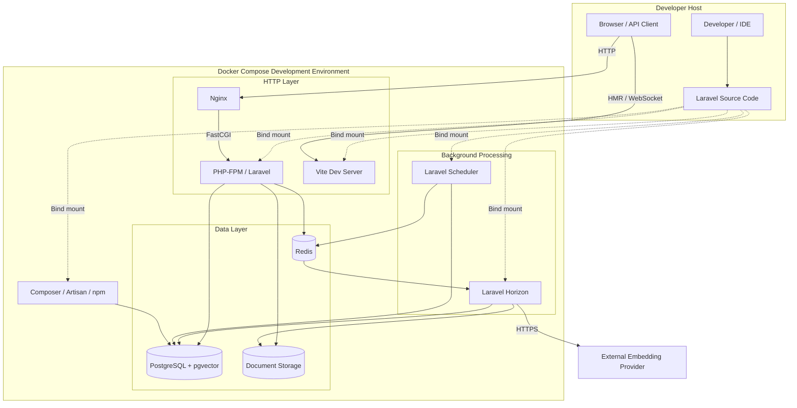

# Development Architecture — Laravel Knowledge API

**Status:** Accepted architectural design — implementation pending  
**Project:** Laravel Docker Production Lab  
**Environment:** Development  
**Related decisions:** ADR-001 through ADR-009  
**Related documents:**

- `02-production-architecture.md`
- `03-request-and-job-flows.md`
- `decisions/README.md`

---

## 1. Purpose

This document defines the development environment architecture for the Laravel Knowledge API.

The objective is to provide a reproducible, isolated, and efficient development environment in which developers can build, debug, and test the application without installing PHP, Composer, PostgreSQL, Redis, or Node.js directly on their host machines.

The environment must support:

- Live Laravel source-code editing.
- HTTP requests through Nginx and PHP-FPM.
- PostgreSQL with the pgvector extension.
- Redis-backed caching and asynchronous queues.
- Laravel Horizon for background job processing.
- Laravel Scheduler for periodic tasks.
- Persistent development database and document storage.
- Vite hot module replacement (HMR).
- Xdebug integration.
- Containerized Composer, Artisan, and npm workflows.
- Local testing and infrastructure debugging.

The development architecture should preserve the same fundamental application responsibilities as production while allowing development-specific tools, filesystem mounts, and debugging capabilities.

**Architectural principle:** Development and production run the same Laravel application, but their runtime environments are intentionally different.

## 2. System Overview

The application is a Laravel monolith deployed across multiple containers according to process responsibility.

Each container executes a specific process or infrastructure service. Multiple containers do not imply multiple independently developed applications.

### 2.1 Architecture diagram



The diagram represents logical communication paths, not unrestricted network connectivity.

Not every container requires access to every other container.

The exact Compose networks and service names will be finalized during implementation.

## 3. Container Responsibilities

| Service     | Primary process            | Responsibility                                 | Long-running     |
| ----------- | -------------------------- | ---------------------------------------------- | ---------------- |
| `nginx`     | Nginx master and workers   | HTTP ingress, static files, FastCGI forwarding | Yes              |
| `php`       | PHP-FPM master and workers | Laravel HTTP request execution                 | Yes              |
| `postgres`  | PostgreSQL server          | Relational data and vector storage             | Yes              |
| `redis`     | Redis server               | Cache, queue transport, Horizon coordination   | Yes              |
| `horizon`   | `php artisan horizon`      | Background job processing and monitoring       | Yes              |
| `scheduler` | Laravel scheduling process | Trigger scheduled tasks                        | Yes              |
| `vite`      | Vite development server    | Frontend development and HMR                   | Yes, when needed |
| `composer`  | Composer CLI               | Dependency installation and management         | No               |
| `artisan`   | Laravel Artisan CLI        | Migrations, application commands, maintenance  | No               |
| `npm`       | Node.js/npm CLI            | Frontend dependency management                 | No               |

Service names are proposed conventions and may be refined when the Compose configuration is implemented.

### 3.1 Nginx

Nginx is the HTTP entrypoint.

Responsibilities:

- Accept incoming HTTP requests.
- Serve publicly accessible static files.
- Forward Laravel application requests to PHP-FPM using FastCGI.
- Apply request-size limits and HTTP-level configuration.
- Expose a development HTTP port on the host.

Nginx does not execute PHP code.

It forwards requests to the PHP-FPM service using the internal Docker network.

The Nginx document root must reference Laravel's `public/` directory.

**Important:** Nginx must never expose Laravel's project root as its public document root because that could make application configuration or source files accessible.

### 3.2 PHP-FPM

PHP-FPM executes Laravel HTTP requests.

Its process model consists of a master process managing a pool of worker processes.

Each available worker can process a FastCGI request.

PHP-FPM does not independently expose an HTTP API.

Nginx forwards FastCGI requests to PHP-FPM, typically on internal TCP port `9000`.

The PHP container requires:

- A supported PHP runtime.
- Composer-installed Laravel dependencies.
- PostgreSQL driver support (`pdo_pgsql`).
- Redis client support.
- Required PHP extensions.
- Access to application source code.
- Access to writable Laravel runtime directories.

The exact PHP version and extensions will be verified and pinned during image engineering.

### 3.3 PostgreSQL + pgvector

PostgreSQL is the primary relational database.

It stores:

- Document metadata.
- Document ownership and processing states.
- Extracted document chunks.
- Embedding vectors.
- Application relational data.

The pgvector extension enables vector storage and similarity operations inside PostgreSQL.

PostgreSQL uses a Docker-managed named volume for database persistence.

The database is accessible to authorized application containers through Docker networking.

Host access may be enabled for development tools, but any published database port must bind to the host loopback interface rather than all network interfaces.

### 3.4 Redis

Redis provides:

- Laravel cache storage.
- Laravel queue transport.
- Horizon coordination and monitoring data.
- Other explicitly configured transient application state.

Redis does not execute queued jobs.

It stores queue-related data that Laravel workers consume.

Redis persistence and eviction policies must be chosen deliberately.

In particular, queue data must not be treated as safely durable merely because Redis runs in a container or has a volume.

The development configuration must avoid eviction policies that unexpectedly remove pending queue jobs.

### 3.5 Laravel Horizon

Horizon executes and monitors Redis-backed Laravel queue workers.

It uses the same Laravel application source and compatible PHP runtime as the HTTP service.

However, its primary process is:

```bash
php artisan horizon
```

Unlike PHP-FPM, Horizon runs continuously and consumes jobs independently of HTTP requests.

Horizon must be able to access:

- Redis.
- PostgreSQL.
- Document storage.
- The external embedding provider.
- The same Laravel configuration and application code as PHP-FPM.

Development concurrency should remain intentionally small to simplify debugging and avoid unnecessary resource consumption.

### 3.6 Laravel Scheduler

The scheduler triggers periodic application tasks.

Examples include:

- Cleaning expired temporary files.
- Retrying or reconciling incomplete processing states.
- Performing maintenance.
- Scheduling document reprocessing.

The scheduler runs as a separate container role using the Laravel application runtime.

The initial development implementation may use:

```bash
php artisan schedule:work
```

This keeps a long-running scheduler process active and invokes due scheduled tasks.

Only one scheduler instance should be active for the development project unless the scheduling strategy explicitly supports multiple instances.

Scheduled commands that must not overlap should use Laravel's scheduling coordination mechanisms.

### 3.7 Vite

Vite provides frontend asset compilation and hot module replacement during development.

It runs in a Node.js-based development container.

The container requires access to relevant frontend source files.

The Vite server must listen on an address reachable through the container network, while the browser must connect through an explicitly published development port.

HMR configuration must account for the distinction between:

- The address on which Vite listens inside the container.
- The host address and port accessed by the browser.
- The WebSocket connection used for hot reload.

Vite is a development tool and is not part of the production runtime architecture.

### 3.8 Utility Containers

Composer, Artisan, and npm are executed through dedicated one-off container workflows.

These utilities allow developers to manage dependencies and execute commands without installing the corresponding runtimes on the host.

Examples:

```bash
docker compose -f compose.dev.yaml run --rm composer install
```

```bash
docker compose -f compose.dev.yaml exec php php artisan migrate
```

```bash
docker compose -f compose.dev.yaml run --rm npm install
```

These commands are illustrative. They become executable only after the corresponding services and configurations have been implemented.

The distinction is important:

- `run` creates a new one-off container using a service definition.
- `exec` starts a process inside an already-running container.

A one-off container is not automatically connected to a running PHP-FPM process. It executes independently while sharing only explicitly configured resources.

## 4. Application Image Strategy

The development environment uses a shared Laravel runtime image lineage.

The development PHP image may include additional tools such as:

- Xdebug.
- Composer.
- Development PHP configuration.
- Debugging utilities.

The PHP-FPM, Horizon, scheduler, and Artisan roles should use compatible runtime images derived from the same application build definition.

They differ primarily in their startup commands.

For example:

| Role                  | Process                     |
| --------------------- | --------------------------- |
| HTTP application      | `php-fpm`                   |
| Background processing | `php artisan horizon`       |
| Scheduler             | `php artisan schedule:work` |
| Migrations            | `php artisan migrate`       |
| Application utilities | `php artisan ...`           |

This avoids maintaining unrelated PHP environments for different application roles.

**Invariant:** All Laravel process roles must use compatible PHP extensions, dependencies, source code, and configuration.

The production architecture will extend this approach by using a shared versioned application image containing the release's application code and dependencies.

## 5. Filesystem and Mount Strategy

Development requires immediate visibility of source-code changes.

The primary mechanism is a bind mount.

### 5.1 Source-code bind mount

Conceptual Compose configuration:

```yaml
services:
  php:
    volumes:
      - ./:/var/www/html
```

This maps the host repository into the PHP container.

Changes made through the host IDE become visible inside the container without rebuilding the image.

The container sees the mounted host files at `/var/www/html`.

This behavior is implemented by Docker's mount configuration, not by copying or synchronizing files into an image layer.

### 5.2 Mount masking

A bind mount hides image filesystem contents at the mount destination for the lifetime of that mount.

If the image contains:

```text
/var/www/html/vendor/
```

but the host project directory does not contain `vendor/`, mounting the host directory over `/var/www/html` hides the image's existing `vendor/` directory.

This is a common source of development failures.

Dependency management must therefore use a deliberate strategy.

Possible approaches include:

- Installing dependencies into the mounted project directory.
- Using a dedicated named volume for dependencies.
- Designing a development entrypoint that safely initializes missing dependencies.

The final strategy will be chosen during the development workflow lessons.

### 5.3 Persistent volumes

Development state must survive ordinary container recreation.

Proposed storage boundaries:

| Data                  | Storage mechanism                   | Persistence requirement                      |
| --------------------- | ----------------------------------- | -------------------------------------------- |
| Laravel source        | Host bind mount                     | Managed through Git and host filesystem      |
| PostgreSQL data       | Named volume                        | Survive container recreation                 |
| Uploaded documents    | Dedicated named volume              | Survive container recreation                 |
| Redis data            | Named volume if persistence enabled | Depends on selected Redis persistence policy |
| Composer dependencies | Bind mount or dedicated volume      | Reusable across container recreation         |
| Node dependencies     | Bind mount or dedicated volume      | Reusable across container recreation         |
| Laravel runtime files | Explicit writable paths             | Depends on file category                     |

Database and uploaded-document volumes must not be shared with the testing environment.

### 5.4 Laravel writable directories

Laravel requires writable locations for certain runtime operations, including:

```text
storage/
bootstrap/cache/
```

The development environment must provide suitable ownership and permissions.

The container's runtime UID/GID should be compatible with host filesystem access where practical.

Broad permission changes such as:

```bash
chmod -R 777 storage bootstrap/cache
```

are not an acceptable default solution.

The correct approach is to understand which Linux user writes the files and configure ownership and permissions accordingly.

### 5.5 Uploaded document storage

Original uploaded documents must not be stored inside disposable container filesystem layers.

A dedicated storage mount should be used for private document content.

The application database stores document metadata and storage references, while the filesystem stores document bytes.

The storage path must be accessible to both:

- The HTTP application, which accepts uploads.
- Horizon workers, which process uploaded documents.

The shared mount must use consistent paths and compatible permissions across these roles.

A Docker volume provides persistence across ordinary container replacement, but it is not a substitute for backup.

## 6. Docker Networking Architecture

Docker Compose creates project-scoped networks and provides service discovery.

Containers attached to the same suitable user-defined network can communicate using service names.

For example, Laravel may use:

```dotenv
DB_HOST=postgres
DB_PORT=5432

REDIS_HOST=redis
REDIS_PORT=6379
```

These are container-internal connection settings.

They are not host-machine connection settings.

### 6.1 Proposed network boundaries

The development environment should use two logical networks:

**Application network**

Connects:

- Nginx.
- PHP-FPM.
- Horizon.
- Scheduler.
- Redis where required.
- Application utility containers.

**Data network**

Connects:

- PHP-FPM.
- Horizon.
- Scheduler where required.
- PostgreSQL.
- Redis where required.
- Database utility containers.

Some services may connect to both networks.

This allows the architecture to express communication requirements rather than attaching every container to a single unrestricted network.

The final topology should remain simple enough for development while preserving meaningful isolation.

### 6.2 Container DNS

Inside a user-defined Docker network, Docker provides DNS resolution for registered service names and aliases.

When Laravel resolves `postgres`, Docker's DNS service returns an address for the corresponding reachable service endpoint.

The resulting TCP connection uses the container's network namespace and Docker networking infrastructure.

`localhost` inside the PHP container refers to that container's own loopback interface.

Therefore:

```dotenv
DB_HOST=localhost
```

would normally be incorrect when PostgreSQL runs in a separate container.

### 6.3 Published ports

Only services requiring host access should publish ports.

Proposed development access:

| Service    | Internal port               | Host access                 |
| ---------- | --------------------------- | --------------------------- |
| Nginx      | 80                          | Local development HTTP port |
| PHP-FPM    | 9000                        | Not published               |
| PostgreSQL | 5432                        | Optional loopback-only port |
| Redis      | 6379                        | Optional loopback-only port |
| Vite       | Configured development port | Local HMR port              |
| Horizon    | Through Laravel HTTP routes | No separate published port  |

The precise host ports will be selected during Compose implementation.

Published ports should normally bind to `127.0.0.1` for local development.

An internal container port does not need to be published for other containers on the same network to reach it.

## 7. HTTP Request Lifecycle

A normal Laravel HTTP request follows this path:

```text
Browser / API Client
        |
        | HTTP
        v
Host Published Port
        |
        v
Docker Networking
        |
        v
Nginx Container
        |
        | FastCGI
        v
PHP-FPM Container
        |
        v
Laravel Application
        |
        | SQL / Redis / Storage
        v
Infrastructure Services
```

### Execution sequence

1. The client connects to the published development HTTP port.
2. Docker's networking configuration forwards traffic to Nginx.
3. Nginx evaluates the request against its configured server and location rules.
4. Static files may be served directly by Nginx.
5. Laravel application requests are forwarded to PHP-FPM using FastCGI.
6. A PHP-FPM worker executes Laravel's front controller.
7. Laravel resolves middleware, routes, and application dependencies.
8. Laravel communicates with PostgreSQL, Redis, or document storage as required.
9. PHP-FPM returns the response to Nginx.
10. Nginx returns the HTTP response to the client.

Nginx and PHP-FPM communicate through FastCGI, not HTTP.

The complete request lifecycle is documented separately in `03-request-and-job-flows.md`.

## 8. Background Job Lifecycle

Document ingestion is performed asynchronously.

The HTTP application accepts an upload and records the processing intent.

Horizon workers perform the expensive processing outside the HTTP request lifecycle.

```text
Client
  |
  v
Nginx
  |
  v
Laravel HTTP API
  |
  +----> Document Storage
  |
  +----> PostgreSQL
  |
  +----> Redis Queue
             |
             v
       Horizon Worker
             |
             +----> Read Document
             |
             +----> Extract Text
             |
             +----> Split Into Chunks
             |
             +----> External Embedding API
             |
             +----> PostgreSQL + pgvector
```

### Processing sequence

1. Laravel validates the uploaded document.
2. The original file is stored in persistent document storage.
3. Laravel creates a document record with an initial processing state.
4. A processing job is dispatched to Redis after the relevant database transaction commits.
5. A Horizon-managed worker retrieves the job.
6. The worker reads the document from shared storage.
7. Text is extracted and divided into chunks.
8. The embedding provider generates vectors for those chunks.
9. PostgreSQL stores chunk metadata and embeddings.
10. Laravel updates the document's processing status.

Database transactions and Redis queue operations do not form one atomic transaction.

After-commit dispatch prevents premature job visibility but does not eliminate every failure window between committing database state and publishing a job.

The ingestion design must eventually support reconciliation or another reliable dispatch strategy.

### Delivery guarantees

The queue-processing architecture must tolerate:

- Duplicate job execution.
- Worker crashes.
- Retry attempts.
- Embedding provider failures.
- Database timeouts.
- Partial processing.
- Redis unavailability.

Workers must use idempotent processing logic rather than assuming exactly-once execution.

Detailed retry and failure semantics will be implemented in Phase 6.

## 9. Development Startup Lifecycle

Docker Compose is responsible for declaring and coordinating the development services.

The Docker CLI sends requests to Docker Engine, which manages container creation, networking, mounts, and process execution.

Conceptually, starting the development environment involves:

1. Compose loads and validates the development configuration.
2. Compose resolves environment-variable interpolation and service definitions.
3. Required images are built or retrieved.
4. Docker Engine creates the necessary networks and volumes.
5. Containers are created with their configured mounts, networks, environment, and process commands.
6. Container processes are started according to the dependency graph.
7. Readiness checks determine when configured dependencies are healthy.
8. Application services begin accepting work when their own prerequisites are satisfied.

**Important:** Container creation order does not guarantee application readiness.

For example, PostgreSQL can have a running container while still initializing its database.

The implementation must use suitable health checks and dependency handling.

Health checks do not replace application-level handling of connections lost after startup.

### Initial database setup

On first startup, PostgreSQL may initialize a new database directory.

On later startups, when the persistent data volume already contains an initialized database, initialization scripts are not automatically replayed.

Database schema changes must be managed through Laravel migrations rather than relying on database-container initialization scripts.

## 10. Development Workflow

The expected development workflow is:

1. Clone the repository.
2. Prepare local configuration using documented development defaults.
3. Build the required development images.
4. Start the infrastructure and application services.
5. Install dependencies through containerized tooling where required.
6. Run Laravel migrations.
7. Start or access the Vite development server when frontend work is required.
8. Develop using the host IDE.
9. Observe code changes through bind mounts.
10. Run tests and debugging commands through containers.

The goal is to avoid hidden host-runtime dependencies.

The host still requires Docker Engine, Docker Compose, Git, and a development editor.

### Rebuilding versus restarting

Not every code change requires an image rebuild.

| Change                      | Typical required action                                               |
| --------------------------- | --------------------------------------------------------------------- |
| Laravel controller code     | Usually immediately visible through bind mount                        |
| Laravel routes              | Usually immediately visible, unless cached                            |
| PHP configuration           | Restart or recreate affected PHP processes                            |
| PHP extension installation  | Rebuild affected image                                                |
| Dockerfile changes          | Rebuild image and recreate container                                  |
| Compose environment changes | Recreate affected container                                           |
| Composer dependencies       | Install/update dependencies; rebuild only if image design requires it |
| Vite frontend source        | HMR or rebuild depending on configuration                             |
| Nginx configuration         | Reload Nginx or recreate service                                      |
| Database schema             | Run Laravel migrations                                                |

PHP OPcache and Laravel's configuration, route, and view caches can affect whether changes become visible immediately.

Development configuration should prioritize predictable code refresh behavior.

## 11. Development Configuration and Secrets

Development configuration must be isolated from production configuration.

Examples of development-specific settings include:

```dotenv
APP_ENV=local
APP_DEBUG=true

DB_CONNECTION=pgsql
DB_HOST=postgres

QUEUE_CONNECTION=redis
REDIS_HOST=redis
```

These are illustrative settings, not a complete environment file.

Development secrets and credentials must not be committed to Git.

The repository should provide a documented example configuration containing safe placeholders.

Laravel configuration caching must be considered when changing environment variables.

If configuration has been cached, changing an environment file does not necessarily change the values used by a running Laravel process.

Long-running workers must also be restarted when relevant application configuration or code changes require a process refresh.

## 12. Development Debugging and Observability

The development environment must support debugging at multiple layers.

### 12.1 Container layer

Inspect:

- Container state.
- Exit codes.
- Restart behavior.
- Environment configuration.
- Mounted filesystems.
- Resource consumption.

### 12.2 Process layer

Inspect:

- PHP-FPM worker processes.
- Horizon workers.
- Scheduler execution.
- Process termination signals.
- Memory consumption.

### 12.3 Network layer

Inspect:

- Compose network membership.
- Service DNS resolution.
- Listening ports.
- TCP connectivity.
- FastCGI connection failures.
- Database and Redis connectivity.

### 12.4 Application layer

Inspect:

- Laravel logs.
- HTTP response codes.
- Exceptions.
- Database queries.
- Failed jobs.
- Horizon metrics.
- Scheduled task execution.

Container logs should be accessible through Docker Compose.

Laravel should use a development-appropriate logging configuration that makes failures observable without exposing secrets.

### 12.5 Xdebug

Xdebug provides interactive PHP debugging.

Its configuration must account for the fact that the PHP process executes inside a container while the IDE runs on the host.

The debugger typically initiates a connection from the container to the IDE.

This is different from publishing a PHP-FPM port to the host.

Xdebug should be enabled only where needed because debugging instrumentation introduces runtime overhead.

## 13. Failure Scenarios

The development environment must make failures reproducible and diagnosable.

| Failure                    | Expected symptom                                  | Investigation                                             |
| -------------------------- | ------------------------------------------------- | --------------------------------------------------------- |
| PostgreSQL unavailable     | Database connection errors                        | Database health, DNS, TCP connectivity, credentials       |
| Redis unavailable          | Cache/queue failures; Horizon cannot process jobs | Redis logs, connection settings, queue state              |
| PHP-FPM unavailable        | Nginx returns gateway errors                      | PHP process, FastCGI upstream, network                    |
| Incorrect bind mount       | Missing source files or dependencies              | Mount configuration and container filesystem              |
| Permission mismatch        | Laravel cannot write runtime files                | UID/GID, ownership, mounted paths                         |
| Vite unreachable           | HMR or asset loading fails                        | Listener, published port, browser WebSocket configuration |
| Worker crash               | Jobs retry or remain pending                      | Horizon logs, retry configuration, failed jobs            |
| Embedding API failure      | Document processing fails or retries              | Provider errors, timeouts, rate limits                    |
| Incorrect service hostname | Connection or DNS resolution failure              | Compose DNS and network membership                        |

### Required failure experiment: Redis outage

Once the development environment is implemented:

1. Start the application and verify normal queue processing.
2. Stop the Redis service.
3. Attempt to dispatch a document-ingestion job.
4. Observe Laravel's error handling.
5. Inspect Horizon's behavior.
6. Restart Redis.
7. Verify recovery and investigate whether any processing intent was lost.

The experiment must distinguish between:

- A successful HTTP response.
- A committed document record.
- A successfully enqueued job.
- A job successfully processed.

These are separate events and should not be treated as one atomic operation.

## 14. Development Versus Production Boundaries

The following development capabilities must not be copied into production without explicit justification:

- Source-code bind mounts.
- Xdebug.
- Vite HMR.
- `APP_DEBUG=true`.
- Development credentials.
- Unrestricted database access.
- Development dependency packages.
- Unnecessary published ports.
- Broad filesystem permissions.

Production uses release-controlled application images, restricted runtime permissions, persistent storage, secure secrets, and explicit deployment procedures.

The core application architecture remains consistent.

## 15. Architectural Decisions

This development architecture follows the approved decisions:

| Decision | Development implication                                          |
| -------- | ---------------------------------------------------------------- |
| ADR-001  | One Laravel application with multiple container process roles    |
| ADR-002  | Nginx forwards requests to PHP-FPM using FastCGI                 |
| ADR-003  | PostgreSQL + pgvector is the primary database                    |
| ADR-004  | Redis and Horizon provide asynchronous processing                |
| ADR-005  | Laravel roles share a common application image lineage           |
| ADR-006  | Bind mounts enable editable development source                   |
| ADR-007  | Uploaded documents use durable storage outside container layers  |
| ADR-008  | Development uses Compose and prepares for single-host production |
| ADR-009  | Embedding integration uses an external provider abstraction      |

The full decision register is maintained in `decisions/README.md`.

## 16. Acceptance Criteria

The development architecture will be considered implemented and verified when:

- [ ] A developer can start the environment using Docker Compose.
- [ ] Laravel responds to HTTP requests through Nginx and PHP-FPM.
- [ ] Laravel connects to PostgreSQL using Compose service discovery.
- [ ] The pgvector extension is available.
- [ ] Laravel connects to Redis.
- [ ] Horizon processes queued jobs.
- [ ] The scheduler executes a scheduled task.
- [ ] Source-code changes become visible without rebuilding the application image.
- [ ] Vite HMR works when frontend tooling is enabled.
- [ ] Xdebug can connect to the host IDE.
- [ ] PostgreSQL data survives container recreation.
- [ ] Uploaded documents survive container recreation.
- [ ] Development ports are restricted to intended host interfaces.
- [ ] Composer, Artisan, and npm can run through containerized workflows.
- [ ] Dependency outages produce observable and diagnosable failures.
- [ ] No host-installed PHP, Composer, PostgreSQL, Redis, or Node.js runtime is required.

These are future implementation acceptance criteria, not claims that the environment is already operational.

## 17. Implementation Roadmap

This document establishes the design for subsequent lessons.

The relevant implementation phases are:

| Phase   | Scope                                                   |
| ------- | ------------------------------------------------------- |
| Phase 1 | Architecture, environment contracts, project foundation |
| Phase 2 | PHP images, BuildKit, permissions, runtime construction |
| Phase 3 | Docker Compose development workflow                     |
| Phase 4 | PostgreSQL persistence and pgvector                     |
| Phase 5 | Laravel Knowledge API and semantic search               |
| Phase 6 | Redis, Horizon, workers, scheduler                      |
| Phase 7 | Docker networking, Nginx, FastCGI, TLS                  |
| Phase 8 | Testing, debugging, failure experiments                 |

The development architecture is intentionally defined before implementation so that future configuration decisions can be evaluated against an explicit design.

---

## Document Status

**Architecture:** Approved design  
**Implementation:** Pending  
**Runtime verification:** Pending  
**Next document:** `02-production-architecture.md`

This document describes the intended development environment. The authoritative GitHub repository and its tested configurations will determine the actual implemented state.
