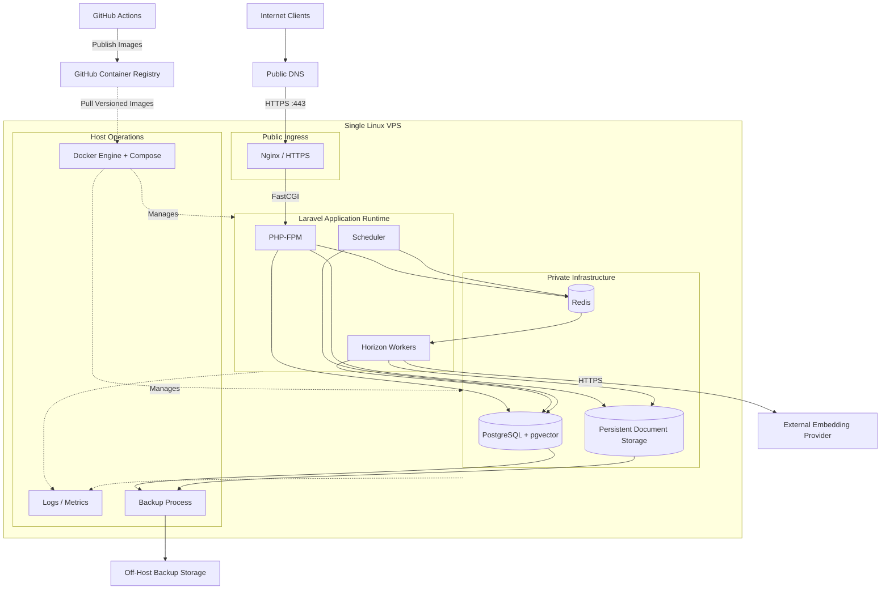

# Production Architecture — Laravel Knowledge API

**Status:** Approved architectural design — implementation pending  
**Project:** Laravel Docker Production Lab  
**Environment:** Production  
**Deployment target:** Single Linux VPS with Docker Engine and Docker Compose  
**Related decisions:** ADR-001 through ADR-009

**Related documents:**

- `01-development-architecture.md`
- `03-request-and-job-flows.md`
- `decisions/README.md`

---

## 1. Purpose

This document defines the target production architecture for the Laravel Knowledge API.

The objective is to deploy the same Laravel application developed locally as a reproducible, secure, observable, and recoverable production system.

The initial deployment platform is a single Linux VPS running Docker Engine and Docker Compose.

This is a deliberate architectural decision.

The project prioritizes understanding production container operations, deployment mechanisms, persistent state, security boundaries, and failure recovery before introducing multi-host orchestration.

The production architecture must support:

- Public HTTPS access to the Laravel API.
- Nginx and PHP-FPM as separate runtime components.
- PostgreSQL with pgvector.
- Redis-backed queues and caching.
- Laravel Horizon workers.
- A dedicated Laravel scheduler.
- Persistent private document storage.
- External embedding provider integration.
- Immutable, versioned application images.
- Automated CI/CD through GitHub Actions and GHCR.
- Runtime configuration and secret management.
- Health checks, structured logging, and monitoring.
- Database and document backups.
- Controlled deployments and rollback procedures.

**Architectural principle:** Application containers are replaceable execution units. Persistent application state must survive their replacement.

## 2. Production Architecture Overview

The system consists of one Laravel application distributed across multiple container process roles, together with supporting infrastructure services.

The architecture does not introduce independent application microservices.

HTTP processing, background processing, scheduling, and application maintenance all use the same Laravel codebase and release version.

### 2.1 Production topology



This diagram describes logical responsibilities and communication paths.

The precise TLS termination configuration, network attachments, storage paths, and backup tooling will be finalized during implementation.

All production services initially run on one host.

Consequently, the host remains a shared failure domain.

## 3. Architectural Boundaries

The architecture is divided into five logical layers.

| Layer                 | Components                                         | Responsibility                                         |
| --------------------- | -------------------------------------------------- | ------------------------------------------------------ |
| Ingress               | Nginx                                              | HTTPS, HTTP routing, static assets, FastCGI forwarding |
| Application           | PHP-FPM, Horizon, Scheduler                        | Execute Laravel application logic                      |
| Data                  | PostgreSQL, Redis, document storage                | Maintain application state                             |
| External integrations | Embedding provider                                 | Generate document embeddings                           |
| Operations            | Docker Engine, Compose, CI/CD, monitoring, backups | Deploy, observe, and recover the system                |

These layers describe responsibility boundaries rather than necessarily requiring separate physical hosts.

### 3.1 One application, multiple processes

The PHP-FPM, Horizon, and scheduler containers execute different processes from the same Laravel application release.

They must not independently install different application dependencies or use unrelated source-code versions.

A production release should identify one compatible set of artifacts:

- Laravel application image.
- Release-matched Nginx image.
- Runtime configuration.
- Database migration version.
- Deployment manifest.

This prevents application code drift between HTTP requests and background processing.

## 4. Production Container Responsibilities

| Service     | Runtime process                       | Publicly accessible           | Persistent state                                       |
| ----------- | ------------------------------------- | ----------------------------- | ------------------------------------------------------ |
| `nginx`     | Nginx                                 | Yes, HTTP/HTTPS as configured | No application state                                   |
| `php`       | PHP-FPM                               | No                            | Shared document storage and runtime writable paths     |
| `horizon`   | Laravel Horizon                       | No                            | Shared document storage; queue state in Redis          |
| `scheduler` | Laravel scheduler                     | No                            | Shared storage if scheduled tasks require it           |
| `postgres`  | PostgreSQL                            | No                            | Database volume                                        |
| `redis`     | Redis                                 | No                            | Optional Redis persistence volume, according to policy |
| `migrate`   | One-off Artisan command               | No                            | Database changes                                       |
| `backup`    | Backup tooling or scheduled host task | No                            | Backup artifacts and off-host destination              |

The migration process is a deployment operation, not a permanently running service.

Backup execution may be managed through host automation or a dedicated containerized workflow.

### 4.1 Nginx

Nginx is the public HTTP entrypoint.

Responsibilities include:

- Terminating HTTPS, if configured as the TLS endpoint.
- Forwarding application requests to PHP-FPM.
- Serving release-matched public assets.
- Enforcing HTTP request limits.
- Producing access and error logs.
- Forwarding appropriate request metadata to Laravel.

Nginx must use Laravel's `public/` directory as its document root.

PHP-FPM is reachable only through an internal Docker network.

The production Nginx configuration must not expose application source files, environment files, private documents, or internal runtime directories.

### 4.2 PHP-FPM

PHP-FPM executes Laravel HTTP requests.

The production PHP image contains:

- The supported PHP runtime.
- Required PHP extensions.
- Laravel application code.
- Production Composer dependencies.
- Optimized autoload metadata.
- Required application bootstrap files.

The image must not depend on a host-mounted Laravel source tree.

PHP-FPM process and worker configuration must be tuned against the VPS memory and CPU budget.

Excessive worker counts can exhaust memory or overload PostgreSQL.

The application must handle dependency failures through appropriate timeouts, exception handling, and response behavior.

### 4.3 Horizon workers

Horizon executes Redis-backed Laravel jobs.

It runs from the same versioned application image as PHP-FPM.

The worker container has its own:

- Startup command.
- Process lifecycle.
- Memory budget.
- Concurrency configuration.
- Restart behavior.
- Logging and health strategy.

Horizon must support graceful shutdown so that deployments do not unnecessarily interrupt active jobs.

Worker shutdown timing must be coordinated with queue retry and visibility timeout configuration.

Jobs must be idempotent because queue delivery can result in repeated execution.

### 4.4 Scheduler

The scheduler executes periodic application tasks.

It runs from the shared Laravel image.

The production configuration must prevent accidental duplicate scheduler instances.

Scheduled tasks requiring mutual exclusion should use appropriate locking mechanisms.

The scheduler must not perform deployment-only tasks such as schema migrations automatically on every startup.

### 4.5 PostgreSQL and pgvector

PostgreSQL is the authoritative relational database.

It stores:

- Document metadata.
- Document processing states.
- Document chunks.
- Embedding vectors.
- Application relational records.

The pgvector extension supports vector storage and similarity search.

The database runs on a private Docker network.

Its data directory is backed by persistent storage.

PostgreSQL image and pgvector versions must be pinned to tested, compatible releases.

Database upgrades require explicit planning because persistent data formats, extension versions, and migration compatibility can affect recovery.

### 4.6 Redis

Redis supports:

- Laravel queues.
- Laravel cache.
- Horizon coordination.
- Other explicitly configured transient application state.

Redis must not be publicly accessible.

Queue reliability requires deliberate Redis configuration.

The production design must document:

- Persistence mode.
- Memory limits.
- Eviction policy.
- Restart behavior.
- Recovery expectations.
- Consequences of Redis data loss.

Redis persistence does not automatically provide the same durability guarantees as PostgreSQL.

If queue and cache workloads share one Redis instance, cache eviction must not silently remove queued work.

Separate Redis instances or carefully isolated policies may become necessary as workload requirements evolve.

## 5. Immutable Application Image Strategy

Production containers must run application code packaged into versioned images.

A production deployment must not require copying source code from the VPS into running containers.

### 5.1 Build once, deploy consistently

The intended release pipeline is:

```text
Git Commit
    |
    v
GitHub Actions
    |
    +--> Automated Tests
    |
    +--> Dependency / Security Checks
    |
    v
Docker BuildKit
    |
    +--> Composer Dependencies
    |
    +--> Frontend Asset Build
    |
    +--> Production PHP Runtime
    |
    +--> Release-Matched Nginx Image
    |
    v
GitHub Container Registry
    |
    v
Production VPS
    |
    v
Docker Compose Deployment
```

The production server pulls published images.

It does not rebuild application images as part of the normal release process.

### 5.2 Shared Laravel image

PHP-FPM, Horizon, scheduler, and one-off Artisan commands use the same Laravel image digest for a given release.

For example:

```text
ghcr.io/<owner>/<application>:<release>
```

The final naming convention will be established during CI/CD implementation.

A mutable tag alone is insufficient for strict reproducibility.

Production deployment records should retain immutable image digests.

### 5.3 Multi-stage builds

The production image should use multi-stage Docker builds.

Conceptually:

1. Resolve and install Composer dependencies.
2. Build frontend assets with Node.js.
3. Assemble the production PHP runtime.
4. Copy only required runtime artifacts.
5. Exclude development tooling and unnecessary build dependencies.

The final runtime image should not contain:

- Xdebug.
- Node.js build tooling unless required at runtime.
- Development Composer dependencies.
- Source-control metadata.
- Build credentials.
- Local development environment files.

### 5.4 Nginx release consistency

Nginx may use a separate image containing:

- Production Nginx configuration.
- Public assets generated for the matching Laravel release.

The Nginx and PHP images must be built from the same source revision or otherwise verified as compatible.

This avoids deploying public assets from one release alongside Laravel code from another.

## 6. Production Filesystem Architecture

Production filesystem design separates immutable application artifacts from mutable runtime state.

### 6.1 Immutable application code

Application code and dependencies are included in the image.

Production Compose must not bind-mount the host repository over the application directory.

This ensures container recreation uses the same packaged application artifact.

### 6.2 Writable Laravel runtime paths

Laravel still requires writable filesystem locations.

Examples include:

```text
storage/
bootstrap/cache/
```

These locations require explicit permissions and storage design.

Not all writable paths require durable persistence.

| Data                     | Persistence requirement                    |
| ------------------------ | ------------------------------------------ |
| Application source       | Immutable image                            |
| Composer dependencies    | Immutable image                            |
| Compiled frontend assets | Versioned image                            |
| Application logs         | Centralized or host-collected              |
| Temporary files          | Disposable writable storage                |
| Framework cache files    | Writable, safely regenerable               |
| Uploaded documents       | Durable persistent storage                 |
| PostgreSQL data          | Durable persistent storage                 |
| Redis state              | According to documented persistence policy |

A read-only root filesystem may be used where the runtime and writable mount layout support it.

### 6.3 Private document storage

Uploaded documents must be stored outside the image and disposable container layers.

The initial production design uses persistent storage on the VPS, exposed to authorized Laravel containers through controlled mounts.

Both PHP-FPM and Horizon must access the same document content.

The document storage must remain private.

Nginx must not serve uploaded private documents directly through an unrestricted public filesystem path.

Downloads should pass through authorization controls or an explicitly designed secure delivery mechanism.

### 6.4 Storage consistency

Document bytes and database metadata live in separate storage systems.

They are not updated through one atomic transaction.

Possible failure cases include:

- A file is stored but its database record is not committed.
- A database record exists but the file is missing.
- A worker crashes after writing processed output.
- A backup captures the database and document filesystem at different logical times.

The application must support reconciliation, cleanup, and recovery procedures for these conditions.

Backups must account for consistency between document metadata and file content.

## 7. Production Networking

The production environment must expose only the services required for external access.

### 7.1 Proposed network topology

Two logical Docker networks are proposed.

**Ingress/application network**

Connects:

- Nginx.
- PHP-FPM.

**Private data network**

Connects:

- PHP-FPM.
- Horizon.
- Scheduler where required.
- PostgreSQL.
- Redis.

Services may attach to multiple networks according to their communication requirements.

The private data network must not publish PostgreSQL or Redis ports to the public host interface.

Containers that require external API access must have an appropriate outbound network path.

A Docker network marked `internal` restricts external connectivity; such a network must not be the only network for workers that call the embedding provider.

### 7.2 Public ports

| Port     | Purpose                                 | Exposure                                      |
| -------- | --------------------------------------- | --------------------------------------------- |
| 443/TCP  | HTTPS                                   | Public                                        |
| 80/TCP   | HTTP redirect or certificate validation | Public when required                          |
| 22/TCP   | SSH administration                      | Restricted by host firewall and access policy |
| 9000/TCP | PHP-FPM                                 | Internal only                                 |
| 5432/TCP | PostgreSQL                              | Internal only                                 |
| 6379/TCP | Redis                                   | Internal only                                 |

Docker-published ports interact with host firewall rules and packet forwarding.

Host security must account for Docker's networking behavior rather than assuming every firewall rule automatically applies to published container ports.

### 7.3 Service discovery

Application containers connect to infrastructure using Docker Compose service names.

Example runtime configuration:

```dotenv
DB_HOST=postgres
DB_PORT=5432

REDIS_HOST=redis
REDIS_PORT=6379
```

Docker's embedded DNS resolves service names for containers attached to the relevant user-defined networks.

Containers should not depend on dynamically assigned container IP addresses.

### 7.4 Outbound dependencies

Horizon workers require outbound HTTPS access to the embedding provider.

Outbound requests must use:

- TLS verification.
- Explicit timeouts.
- Bounded retries.
- Rate-limit handling.
- Secure credential injection.

Provider failures must not exhaust workers indefinitely or produce uncontrolled retry storms.

## 8. HTTPS and Reverse Proxy Security

Public API traffic must use HTTPS.

The initial architecture permits TLS termination at Nginx.

Certificate issuance and renewal must be automated or covered by a documented operational procedure.

The configuration must handle:

- TLS certificates and private keys.
- HTTP-to-HTTPS redirects.
- Correct host and scheme forwarding.
- Request-body size limits.
- Trusted proxy configuration.
- Secure response headers where appropriate.

If another reverse proxy or load balancer is introduced later, Laravel's trusted proxy configuration must be updated to match the new trust boundary.

Production TLS private keys must not be committed to Git or embedded into application images.

## 9. Runtime Configuration and Secrets

Production configuration must be supplied at runtime.

Secrets must not be baked into Docker images.

Examples include:

- `APP_KEY`.
- Database credentials.
- Redis credentials where configured.
- Embedding provider API keys.
- External service credentials.

The implementation may use Docker Compose secrets, protected environment files, or another explicitly selected secret-management mechanism.

Compose secrets are not equivalent to a managed secret service with automatic rotation and access auditing.

On a single-host Compose deployment, host access and Docker daemon privileges remain critical security boundaries.

### 9.1 Laravel configuration caching

Laravel commonly uses configuration caching in production.

Configuration caching changes how environment variables are read.

The deployment process must ensure cached configuration corresponds to the actual runtime environment.

A build-time configuration cache must not accidentally capture development credentials or environment-specific secrets.

### 9.2 Configuration contract

The same release artifact should be deployable to an appropriate target environment without rebuilding solely to change environment-specific configuration.

Runtime configuration must be validated before accepting production traffic.

Missing critical secrets or invalid connection settings should cause a visible startup or readiness failure rather than silently using unsafe defaults.

## 10. Container Security Model

Containers provide process isolation, not a complete security boundary equivalent to separate virtual machines.

Containers share the host Linux kernel.

The production security design must consider:

- Linux namespaces.
- cgroups.
- Linux capabilities.
- Container users and filesystem ownership.
- Mount permissions.
- Network exposure.
- Image provenance.
- Docker daemon access.

### 10.1 Least privilege

Application processes should run as non-root users wherever practical.

Containers should receive only required filesystem access and capabilities.

Avoid:

- Privileged containers.
- Unnecessary host filesystem mounts.
- Docker socket mounts inside application containers.
- Broad writable directories.
- Unrestricted network exposure.

### 10.2 Image security

Images must use supported, pinned base versions.

CI should perform appropriate dependency and image vulnerability checks.

The release process should retain traceability between:

- Git commit.
- Build workflow.
- Image digest.
- Deployed release.

### 10.3 Application security

Production Laravel configuration must disable development debugging.

Horizon access must be authenticated and authorized.

Uploaded files require validation, access controls, and appropriate processing safeguards.

Embedding provider credentials must not appear in application logs or HTTP responses.

## 11. Production Startup and Readiness

Docker Compose coordinates service creation and startup.

However, container startup does not guarantee service readiness.

### 11.1 Startup sequence

A typical initial deployment involves:

1. Provisioning the Linux host.
2. Installing and configuring Docker Engine and Compose.
3. Creating required directories, volumes, and networks.
4. Provisioning production configuration and secrets.
5. Pulling the approved image digests.
6. Starting PostgreSQL and Redis.
7. Waiting for required infrastructure readiness.
8. Executing database migrations through a controlled one-off process.
9. Starting or replacing Laravel application roles.
10. Validating application health.
11. Enabling or confirming public traffic.
12. Running production smoke tests.

The precise sequence must support both first deployment and subsequent releases.

### 11.2 Health checks

Health checks should distinguish different levels of health.

| Health level          | Question                                         |
| --------------------- | ------------------------------------------------ |
| Process liveness      | Is the expected process running?                 |
| Service readiness     | Can the service perform its required work?       |
| Dependency health     | Are required infrastructure dependencies usable? |
| External availability | Can a client successfully access the public API? |

A successful PHP-FPM process check does not prove that Laravel can query PostgreSQL.

Likewise, a healthy PostgreSQL container does not prove that the application schema is compatible with the deployed release.

### 11.3 Restart behavior

Containers should use appropriate restart policies.

Restart policies can recover processes after crashes or host restarts.

They do not fix:

- Invalid application configuration.
- Corrupt persistent data.
- Incompatible migrations.
- Missing secrets.
- Disk exhaustion.
- Unavailable external providers.

Repeated restarts must be observable and investigated.

## 12. Production Request and Job Execution

### 12.1 HTTP request path

```text
Internet Client
      |
      | HTTPS
      v
Nginx
      |
      | FastCGI
      v
PHP-FPM
      |
      v
Laravel
      |
      +----> PostgreSQL
      |
      +----> Redis
      |
      +----> Document Storage
```

Nginx handles HTTP ingress.

PHP-FPM executes Laravel.

Infrastructure services remain private.

### 12.2 Document processing path

```text
HTTP Upload
     |
     v
Laravel API
     |
     +----> Persistent Document Storage
     |
     +----> PostgreSQL Metadata
     |
     +----> Redis Queue
                  |
                  v
             Horizon Worker
                  |
                  +----> Read Document
                  |
                  +----> Extract / Chunk
                  |
                  +----> Embedding Provider
                  |
                  +----> PostgreSQL + pgvector
```

The API should return an appropriate asynchronous-processing response once the required upload and enqueue guarantees have been satisfied.

Processing status is tracked independently from the original HTTP request.

### 12.3 Queue delivery semantics

Queue jobs must tolerate at-least-once execution.

Workers can crash after performing a side effect but before acknowledging successful completion.

Retries may therefore repeat the same operation.

The application must use idempotency, database constraints, processing state transitions, and appropriate locking to prevent duplicate or inconsistent results.

Redis and PostgreSQL operations are not one distributed transaction.

The system must explicitly handle failures between database commits and queue publication.

## 13. CI/CD and Release Architecture

GitHub Actions is the planned CI/CD platform.

GitHub Container Registry stores versioned application images.

### 13.1 Continuous integration

CI should:

1. Check out the intended Git revision.
2. Install or resolve required dependencies.
3. Run code quality checks.
4. Execute automated tests.
5. Execute integration tests against isolated infrastructure.
6. Perform relevant dependency and security checks.
7. Build production images.
8. Validate image artifacts.
9. Publish approved release images.

Production publication must be gated by the project's required checks.

### 13.2 Continuous deployment

Deployment should:

1. Select an approved release.
2. Retrieve its image digests.
3. Verify deployment configuration and required secrets.
4. Pull images to the VPS.
5. Execute required pre-deployment checks.
6. Run compatible database migrations.
7. Replace the relevant application containers.
8. Verify health and application behavior.
9. Record the deployed release.
10. Trigger rollback or recovery procedures when validation fails.

### 13.3 Release consistency

A release should not mix arbitrary application versions across PHP-FPM, Horizon, and scheduler containers.

The deployment procedure must account for temporarily overlapping old and new processes during replacement.

Database migrations must be compatible with that overlap where the deployment strategy requires it.

## 14. Deployment and Rollback Strategy

The initial deployment target is a single Docker Compose host.

This provides straightforward service management but does not inherently provide zero-downtime deployment.

### 14.1 Initial deployment approach

The first production implementation may use controlled container recreation.

Temporary interruption may occur while application containers are replaced.

This limitation must be documented and measured.

### 14.2 Rollback

Application rollback means returning to a previously approved set of image digests and compatible runtime configuration.

Rollback does not automatically reverse database migrations.

A migration that removes or changes data can make an older application release incompatible.

Therefore, production migrations should favor backward-compatible evolution.

A typical safe schema evolution follows:

1. Add new compatible schema structures.
2. Deploy application code that supports the transition.
3. Migrate or backfill data.
4. Verify application behavior.
5. Remove obsolete structures only in a later controlled release.

### 14.3 Interrupted deployments

Deployment procedures must account for:

- Failed image pulls.
- Migration failures.
- Unhealthy new containers.
- Interrupted SSH sessions.
- Worker shutdown delays.
- Partial service replacement.

The deployment process must preserve enough state to identify the last known-good release and recover deterministically.

## 15. Persistent State and Backup Architecture

The initial production deployment has three important state categories.

| State               | Primary location                | Recovery requirement                   |
| ------------------- | ------------------------------- | -------------------------------------- |
| PostgreSQL database | Persistent database volume      | Backup and restore                     |
| Uploaded documents  | Persistent document storage     | Backup and restore                     |
| Redis queue state   | Redis persistence if configured | Defined recovery/reconciliation policy |

Application images are not backed up as application data.

They are reproducible artifacts retained in a container registry.

### 15.1 PostgreSQL backups

The backup design must include:

- Scheduled backups.
- Retention policy.
- Off-host storage.
- Restore validation.
- Database version compatibility.
- pgvector extension compatibility.

A database volume is not itself a backup.

### 15.2 Document backups

Document storage must be backed up independently.

Backups must preserve the relationship between document metadata and stored file content.

Restore procedures must account for consistency between PostgreSQL and document storage.

### 15.3 Off-host backups

Backups must not exist exclusively on the same VPS.

A complete host failure could destroy both application data and local backup copies.

Off-host storage must use appropriate access controls and encryption.

### 15.4 Recovery objectives

The project must define:

- **RPO:** Maximum acceptable amount of lost data.
- **RTO:** Maximum acceptable recovery duration.

Concrete targets will be selected after evaluating workload requirements, backup frequency, storage costs, and recovery tests.

## 16. Observability Architecture

Production must provide enough information to identify failures across the HTTP, application, queue, database, and host layers.

### 16.1 Logging

Required log sources include:

- Nginx access and error logs.
- PHP-FPM logs.
- Laravel application logs.
- Horizon and worker logs.
- PostgreSQL logs.
- Redis logs.
- Docker and host-level operational logs.

Application containers should emit appropriate logs to stdout and stderr where practical.

Logs require retention and rotation policies.

Sensitive data, credentials, private document contents, and provider tokens must not be logged.

### 16.2 Metrics

The monitoring architecture should eventually capture:

- HTTP request rate and latency.
- HTTP error rate.
- PHP-FPM worker utilization.
- Queue depth and job processing time.
- Failed jobs.
- PostgreSQL connections and query performance.
- Redis memory and queue health.
- Container CPU and memory.
- Host disk utilization.
- Backup success and age.

Prometheus and Grafana are planned options for metrics collection and visualization.

### 16.3 Correlation

Requests and background jobs should carry correlation identifiers where practical.

This enables tracing a document-processing operation across:

```text
HTTP Request
    |
    v
Document Record
    |
    v
Queue Job
    |
    v
Embedding Provider Call
    |
    v
Database Update
```

A correlation identifier does not replace distributed tracing, but it provides a useful baseline for operational debugging.

## 17. Resource Management and Capacity

All services share one VPS.

CPU, memory, disk, and network resources must be allocated deliberately.

### 17.1 PHP-FPM concurrency

PHP-FPM worker counts affect:

- Concurrent HTTP request capacity.
- PHP memory consumption.
- Database connection pressure.
- Request latency under load.

Worker counts must be based on observed memory usage and workload characteristics.

### 17.2 Horizon concurrency

Horizon worker counts affect:

- Queue throughput.
- PHP memory consumption.
- PostgreSQL concurrency.
- Embedding provider request volume.
- External API rate-limit pressure.

Increasing worker count does not guarantee proportional throughput.

The embedding provider or database may become the bottleneck.

### 17.3 PostgreSQL and pgvector

Vector search workloads compete with relational queries for database resources.

Potential pressure points include:

- Memory.
- CPU.
- Disk I/O.
- Connection count.
- Vector index maintenance.
- Query planning and execution.

The initial architecture intentionally accepts this trade-off.

Separate vector infrastructure should be considered only when measurements justify the added complexity.

### 17.4 Disk capacity

Disk exhaustion can affect:

- PostgreSQL writes.
- Uploaded documents.
- Container logs.
- Image pulls.
- Temporary processing files.
- Backups.

Host disk monitoring is a required operational capability.

## 18. Failure Domains and Recovery

The architecture must define expected behavior for common failures.

| Failure                   | Impact                                        | Recovery mechanism                                  |
| ------------------------- | --------------------------------------------- | --------------------------------------------------- |
| PHP-FPM crash             | HTTP API unavailable or degraded              | Container restart and investigation                 |
| Nginx failure             | Public API unavailable                        | Restart and health validation                       |
| Horizon crash             | Background processing interrupted             | Restart, retry, idempotent recovery                 |
| Scheduler failure         | Scheduled tasks delayed                       | Restart and missed-task reconciliation where needed |
| PostgreSQL failure        | Persistent application operations unavailable | Service recovery or database restore                |
| Redis failure             | Queue/cache operations unavailable            | Redis recovery and job reconciliation               |
| Embedding provider outage | Document processing delayed                   | Bounded retries and failure handling                |
| Disk exhaustion           | Writes and deployments may fail               | Capacity recovery and data integrity checks         |
| VPS failure               | Entire deployment unavailable                 | Host replacement and off-host restore               |
| Bad release               | Application errors or incompatibility         | Application rollback and recovery procedure         |

### 18.1 Single-host limitation

Docker Compose does not provide automatic multi-host failover or scheduling.

If the VPS becomes unavailable, all locally hosted services become unavailable.

Restart policies do not solve host-level failure.

This is an accepted limitation of ADR-008.

### 18.2 Recovery testing

The final project must demonstrate:

- Recovery after container recreation.
- Recovery after host restart.
- Database restoration.
- Document storage restoration.
- Worker retry behavior.
- Rollback to a compatible application release.
- Recovery from an interrupted deployment.

A backup or recovery procedure is not considered verified until it has been tested.

## 19. Scaling Strategy

The initial architecture favors controlled vertical scaling.

### 19.1 Vertical scaling

The VPS may be upgraded with additional CPU, memory, or storage.

This is the simplest initial scaling mechanism.

It does not eliminate the single-host failure domain.

### 19.2 HTTP scaling

Multiple PHP-FPM replicas may be introduced if supported by the Compose and Nginx configuration.

Shared state must remain outside individual application containers.

Connection limits and resource budgets must be revisited.

### 19.3 Worker scaling

Horizon worker concurrency can be increased independently of HTTP processing.

This is valuable because document ingestion and HTTP requests have different resource and latency characteristics.

Worker scaling must account for queue semantics, database pressure, and embedding provider limits.

### 19.4 Future architectural evolution

Potential future changes include:

- Managed PostgreSQL.
- Managed Redis.
- Object storage for documents.
- Multiple application hosts.
- Dedicated load balancing.
- ECS or Kubernetes orchestration.

These changes are not required for the initial production architecture.

They should be introduced in response to measured operational requirements rather than architectural preference alone.

## 20. Development Versus Production Contract

| Concern            | Development                   | Production                                     |
| ------------------ | ----------------------------- | ---------------------------------------------- |
| Laravel source     | Host bind mount               | Immutable application image                    |
| PHP runtime        | Development tooling enabled   | Minimal supported runtime                      |
| Xdebug             | Available                     | Disabled                                       |
| Vite               | Development server and HMR    | Prebuilt static assets                         |
| Nginx              | Local HTTP ingress            | Public HTTPS ingress                           |
| PostgreSQL         | Local persistent volume       | Persistent backed-up storage                   |
| Redis              | Local queue/cache service     | Restricted service with documented persistence |
| Uploaded documents | Development persistent volume | Durable backed-up storage                      |
| Secrets            | Local protected configuration | Secure runtime injection                       |
| Debugging          | Interactive tools             | Structured logs and monitoring                 |
| Images             | Rebuilt during development    | Versioned and published through CI             |
| Deployment         | Developer-controlled Compose  | Controlled release process                     |
| Networking         | Local ports where needed      | Minimal public ingress                         |
| Recovery           | Local recreation and reset    | Tested backup, restore, and rollback           |

The application codebase remains shared.

Environment differences are expressed through build targets, runtime configuration, networking, mounts, and operational policies.

## 21. Architectural Decisions

| Decision | Production implication                                                            |
| -------- | --------------------------------------------------------------------------------- |
| ADR-001  | One Laravel monolith with independently managed runtime process roles             |
| ADR-002  | Nginx handles HTTP ingress and forwards PHP requests through FastCGI              |
| ADR-003  | PostgreSQL and pgvector share the primary database resource budget                |
| ADR-004  | Redis and Horizon provide asynchronous job processing                             |
| ADR-005  | PHP-FPM, Horizon, scheduler, and Artisan use the same versioned Laravel image     |
| ADR-006  | Production does not depend on editable host source mounts                         |
| ADR-007  | Uploaded documents use independently durable and backed-up storage                |
| ADR-008  | Initial deployment runs on a single Linux VPS using Docker Compose                |
| ADR-009  | Embedding provider integration remains isolated behind an application abstraction |

The detailed rationale and trade-offs are maintained in `decisions/README.md`.

## 22. Production Acceptance Criteria

The production architecture will be considered implemented and verified when:

- [ ] Production images are built through a reproducible CI pipeline.
- [ ] Application images are published to GHCR with traceable versions and digests.
- [ ] PHP-FPM, Horizon, and scheduler run from the same release image.
- [ ] Nginx serves the API through valid HTTPS.
- [ ] PHP-FPM is not publicly exposed.
- [ ] PostgreSQL and Redis are not publicly exposed.
- [ ] Production code does not depend on host source bind mounts.
- [ ] Required secrets are supplied securely at runtime.
- [ ] Laravel production debugging is disabled.
- [ ] Application processes use restricted privileges.
- [ ] PostgreSQL data survives container recreation.
- [ ] Uploaded documents survive container recreation.
- [ ] Horizon processes and retries jobs correctly.
- [ ] Scheduler tasks execute without unintended duplication.
- [ ] Health checks detect meaningful service failures.
- [ ] Logs and metrics support operational diagnosis.
- [ ] Database and document backups are stored off-host.
- [ ] Database and document restoration is tested.
- [ ] Deployment automation executes required validation.
- [ ] Application rollback is tested with compatible database migrations.
- [ ] Host restart recovery is verified.
- [ ] The single-host availability limitation is documented.

These are implementation and verification requirements, not claims about the current deployment state.

## 23. Implementation Roadmap

This architecture will be implemented incrementally through the following course phases.

| Phase    | Scope                                                 |
| -------- | ----------------------------------------------------- |
| Phase 9  | Production image engineering                          |
| Phase 10 | Security and runtime configuration                    |
| Phase 11 | Production deployment on Linux                        |
| Phase 12 | CI/CD and release engineering                         |
| Phase 13 | Observability and performance                         |
| Phase 14 | Reliability, scaling, disaster recovery, and capstone |

The architecture is defined before production implementation so that image design, Compose configuration, security controls, and deployment procedures can be evaluated against a consistent target.

---

## Document Status

**Architecture:** Approved design  
**Implementation:** Pending  
**Production verification:** Pending  
**Next document:** `03-request-and-job-flows.md`

This document defines the intended single-host production architecture. Actual implementation and verification must be established from the authoritative GitHub repository and observed runtime behavior.
