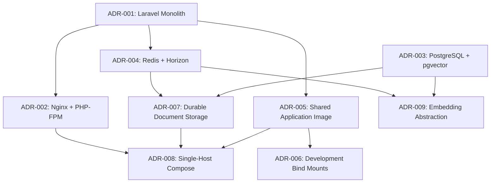

# Architecture Decision Register — Laravel Knowledge API

**Project:** Laravel Docker Production Lab  
**Status:** ADR-001 through ADR-009 accepted  
**Architecture stage:** Design approved — implementation pending  
**Source of truth:** [Laravel Docker Production Lab](https://github.com/EslamKamel89/laravel_docker_production_lab)

**Related documents:**

- [`../01-development-architecture.md`](../01-development-architecture.md)
- [`../02-production-architecture.md`](../02-production-architecture.md)
- [`../03-request-and-job-flows.md`](../03-request-and-job-flows.md)

---

## 1. Purpose

This register documents the architectural decisions governing the Laravel Knowledge API.

Its purpose is to preserve the reasoning behind important engineering choices so that future implementation changes can be evaluated against explicit requirements and trade-offs.

An Architecture Decision Record (ADR) answers five questions:

1. What problem are we solving?
2. What decision did we make?
3. Why did we choose it?
4. What consequences and trade-offs do we accept?
5. Under what conditions should we reconsider it?

An ADR records a decision and its rationale. It does not prove that the decision has been implemented correctly.

The authoritative GitHub repository, automated tests, and observed runtime behavior establish implementation status.

## 2. Decision Register

| ID      | Decision                                            | Status   | Primary concern                      |
| ------- | --------------------------------------------------- | -------- | ------------------------------------ |
| ADR-001 | One Laravel monolith with multiple container roles  | Accepted | Application architecture             |
| ADR-002 | Nginx + PHP-FPM                                     | Accepted | HTTP execution                       |
| ADR-003 | PostgreSQL + pgvector                               | Accepted | Relational and vector persistence    |
| ADR-004 | Redis + Laravel Horizon                             | Accepted | Asynchronous processing              |
| ADR-005 | Shared versioned Laravel application image          | Accepted | Build and release consistency        |
| ADR-006 | Bind mounts only for editable development source    | Accepted | Filesystem and environment isolation |
| ADR-007 | Durable document storage outside application images | Accepted | Persistent files and recovery        |
| ADR-008 | Single-host Docker Compose production initially     | Accepted | Deployment and orchestration         |
| ADR-009 | External embedding provider abstraction             | Accepted | External integrations                |

All nine decisions were approved during Lesson 1.2.

Their acceptance does not imply that implementation, deployment, or operational verification has been completed.

## 3. Decision Lifecycle

An ADR may have one of the following statuses.

| Status      | Meaning                                       |
| ----------- | --------------------------------------------- |
| Proposed    | Under discussion; not yet approved            |
| Accepted    | Approved for implementation                   |
| Implemented | Corresponding code and configuration exist    |
| Verified    | Required tests and runtime checks have passed |
| Superseded  | Replaced by a newer architectural decision    |
| Deprecated  | No longer recommended for new implementation  |

Status changes must be supported by evidence.

For example, an accepted decision should not be marked verified merely because a Docker Compose file contains the intended service names.

Verification may require integration tests, failure experiments, production smoke tests, or recovery exercises.

When a decision changes materially, create a new ADR or record an explicit amendment rather than silently rewriting the original rationale.

---

# ADR-001 — One Laravel Monolith with Multiple Container Roles

**Status:** Accepted  
**Category:** Application architecture  
**Related decisions:** ADR-004, ADR-005, ADR-008

## Context

The Laravel Knowledge API requires several independently running processes:

- HTTP request handling.
- Background document ingestion.
- Queue monitoring.
- Scheduled task execution.
- Administrative and migration commands.

These processes have different lifecycles and resource requirements.

However, they belong to one application domain and share the same Laravel codebase, database schema, configuration contracts, and business rules.

The existence of multiple processes does not require multiple microservices.

## Decision

Build one Laravel monolithic application and execute it through multiple container roles.

The primary roles are:

| Role           | Process           | Responsibility                              |
| -------------- | ----------------- | ------------------------------------------- |
| HTTP           | PHP-FPM           | Execute web requests                        |
| Worker         | Laravel Horizon   | Process background jobs                     |
| Scheduler      | Laravel Scheduler | Trigger periodic tasks                      |
| Administrative | Artisan CLI       | Execute migrations and maintenance commands |

All roles use the same application codebase.

In production, they use the same versioned Laravel application image.

## Rationale

The architecture separates **process lifecycles** without unnecessarily separating **application ownership**.

This allows HTTP and background processing to have different:

- Container restart policies.
- Resource limits.
- Concurrency settings.
- Scaling strategies.
- Health checks.
- Operational monitoring.

At the same time, the application retains one coherent domain model and release process.

## Alternatives Considered

### Separate microservices

Create independent HTTP, ingestion, and scheduling services.

Rejected for the initial architecture because it would introduce:

- Additional deployment boundaries.
- Independent API contracts.
- Cross-service authentication.
- Distributed data consistency concerns.
- More complex observability.
- Independent release coordination.

The current workload does not justify these costs.

### One container running all application processes

Run PHP-FPM, workers, and scheduler under one process supervisor.

Rejected as the default because it couples unrelated process lifecycles.

A worker failure should not require restarting the HTTP runtime, and worker concurrency should be configurable independently.

## Consequences

**Benefits**

- One application codebase.
- Clear process responsibilities.
- Independent runtime scaling.
- Shared domain logic.
- Reduced architectural complexity.

**Costs**

- All application roles share a release lifecycle.
- Schema and queue payload changes require compatibility planning.
- Shared application defects may affect multiple process roles.

## Implementation Requirements

- Separate Compose services for long-running roles.
- Shared Laravel application source.
- Shared versioned application image in production.
- Role-specific startup commands.
- Explicit resource and restart configuration.
- No unnecessary application microservice boundaries.

## Reconsider When

- A subsystem requires independent ownership or deployment.
- Different components require incompatible runtime stacks.
- Organizational or scaling requirements justify service separation.
- Operational measurements show a clear benefit from independent service boundaries.

---

# ADR-002 — Nginx + PHP-FPM

**Status:** Accepted  
**Category:** HTTP architecture  
**Related decisions:** ADR-001, ADR-005, ADR-008

## Context

The Laravel API requires an HTTP entrypoint and a PHP runtime.

These responsibilities are different.

Nginx handles HTTP connections, static files, routing rules, and reverse-proxy concerns.

PHP-FPM manages PHP worker processes and executes Laravel through FastCGI.

Combining these responsibilities without understanding their boundaries can produce incorrect port exposure, filesystem configuration, and process management.

## Decision

Use Nginx as the HTTP entrypoint and PHP-FPM as the Laravel execution runtime.

Nginx forwards PHP requests to PHP-FPM using FastCGI.

Conceptual request path:

```text
Client
  |
  | HTTP / HTTPS
  v
Nginx
  |
  | FastCGI
  v
PHP-FPM
  |
  v
Laravel
```

PHP-FPM is not publicly exposed.

## Rationale

This architecture provides explicit separation between:

- HTTP connection handling.
- PHP execution.
- Static asset delivery.
- Application request processing.

It also provides a practical foundation for learning Nginx configuration, FastCGI, Docker networking, and production PHP process management.

## Alternatives Considered

### Apache with mod_php

A valid deployment model, but not selected because the project explicitly targets Nginx and PHP-FPM.

### Laravel Octane

Octane uses a different long-running application execution model.

It may improve performance for suitable workloads, but introduces additional application lifecycle and worker-state considerations.

It is not required for the initial project.

### PHP built-in development server

Useful for simple development workflows, but not the selected production HTTP architecture.

## Consequences

**Benefits**

- Clear HTTP and PHP boundaries.
- Independent Nginx and PHP configuration.
- Direct control over FastCGI behavior.
- Efficient static asset serving.
- Consistent development and production request architecture.

**Costs**

- Two runtime components must be configured.
- Nginx and PHP-FPM must agree on application paths.
- FastCGI and network failures introduce additional debugging considerations.
- Release-matched public assets require coordination.

## Implementation Requirements

- Nginx document root points to Laravel's `public/`.
- FastCGI parameters identify the correct PHP script.
- PHP-FPM listens on an internal network endpoint.
- Nginx and PHP-FPM share compatible public-file paths.
- Production HTTPS is configured at the chosen ingress boundary.
- Private Laravel files are never exposed by Nginx.

## Reconsider When

- Measured performance requirements justify another PHP runtime.
- A different hosting platform imposes a specific ingress model.
- The application adopts an execution model incompatible with the current PHP-FPM assumptions.

---

# ADR-003 — PostgreSQL + pgvector

**Status:** Accepted  
**Category:** Data architecture  
**Related decisions:** ADR-007, ADR-009

## Context

The application requires both conventional relational data and vector similarity search.

Relational data includes:

- Document ownership.
- Document metadata.
- Processing states.
- Application records.

Vector data includes embeddings generated from document chunks.

A separate vector database could satisfy the similarity-search requirement, but would introduce another persistence system and additional consistency boundaries.

## Decision

Use PostgreSQL as the primary relational database and pgvector for vector storage and similarity operations.

The application will store document chunks and embeddings in PostgreSQL alongside relational metadata.

## Rationale

PostgreSQL provides:

- Relational integrity.
- Transactions.
- Constraints.
- Indexing.
- SQL querying.
- Mature operational tooling.

pgvector extends PostgreSQL with vector types and similarity-search capabilities.

Keeping relational and vector data in one database simplifies:

- Data ownership.
- Transactional persistence.
- Backup and recovery.
- Authorization-aware queries.
- Initial operational architecture.

## Alternatives Considered

### Dedicated vector database

Examples include specialized vector-search platforms.

Not selected initially because the project does not yet demonstrate workload requirements that justify a second database.

### External vector-search service

Could reduce infrastructure management, but introduces additional cost, network dependencies, and consistency concerns.

### PostgreSQL without pgvector

Insufficient for the intended native vector-search implementation.

## Consequences

**Benefits**

- One authoritative relational and vector database.
- Shared transaction boundary for document metadata and embeddings.
- Fewer infrastructure services.
- SQL-based authorization filtering.
- Unified backup and recovery procedures.

**Costs**

- Vector workloads consume PostgreSQL resources.
- Large indexes may increase memory and storage requirements.
- Approximate search requires careful tuning.
- Database scaling becomes a shared concern.

## Implementation Requirements

- Pin compatible PostgreSQL and pgvector versions.
- Enable the pgvector extension through controlled database initialization or migrations.
- Define embedding dimensions explicitly.
- Validate embedding model compatibility.
- Implement exact similarity search before introducing approximate indexes.
- Benchmark HNSW and IVFFlat when appropriate.
- Back up and restore both relational and vector data.
- Apply document authorization filters during queries.

## Reconsider When

- Vector data grows beyond practical PostgreSQL capacity.
- Search workloads materially degrade transactional performance.
- Specialized retrieval requirements exceed pgvector capabilities.
- Benchmarks demonstrate that a separate vector system provides sufficient benefit.

---

# ADR-004 — Redis + Laravel Horizon

**Status:** Accepted  
**Category:** Asynchronous processing  
**Related decisions:** ADR-001, ADR-003, ADR-005

## Context

Document ingestion may involve:

- Reading uploaded documents.
- Extracting text.
- Splitting content into chunks.
- Calling external embedding APIs.
- Writing vectors to PostgreSQL.

These operations can be slow, expensive, and failure-prone.

Executing them synchronously inside HTTP requests would increase request latency and expose clients to external-provider delays.

## Decision

Use Redis as the queue transport and Laravel Horizon to manage and monitor background workers.

HTTP requests record processing intent and arrange asynchronous execution.

Horizon workers perform document ingestion independently.

## Rationale

Queues decouple request acceptance from expensive processing.

They allow:

- Independent worker concurrency.
- Retry policies.
- Background processing.
- Queue monitoring.
- Resource isolation between HTTP and ingestion workloads.

Horizon provides Laravel-specific management and visibility for Redis-backed queues.

## Alternatives Considered

### Synchronous processing

Rejected because embedding generation and document extraction should not hold HTTP requests open unnecessarily.

### PostgreSQL-backed Laravel queues

A valid alternative that could reduce infrastructure dependencies.

Not selected because Redis and Horizon are explicit learning and architectural requirements.

### RabbitMQ or another message broker

Could be appropriate for more specialized messaging requirements, but adds infrastructure complexity not justified by the initial application.

## Consequences

**Benefits**

- Shorter upload request lifecycle.
- Independently configurable worker concurrency.
- Retry and failure-handling capabilities.
- Horizon monitoring.
- Better isolation of slow external API calls.

**Costs**

- Additional stateful infrastructure.
- At-least-once job execution.
- Redis durability and memory-policy concerns.
- Database/queue dual-write consistency challenges.
- Worker lifecycle and deployment coordination.

## Reliability Requirements

Redis queue operations and PostgreSQL transactions are not automatically atomic.

The implementation must account for:

- Failed queue publication.
- Worker crashes.
- Duplicate job execution.
- Lost or delayed processing attempts.
- Redis outages.
- External API timeouts.
- Partial database writes.

Laravel's after-commit dispatch behavior can prevent workers from observing uncommitted database records.

However, after-commit dispatch alone does not guarantee reliable publication after a successful database commit.

The initial implementation will use after-commit dispatch with an explicit reconciliation mechanism unless a transactional outbox is selected during reliability implementation.

## Implementation Requirements

- Redis must not be publicly exposed.
- Horizon must run in a dedicated application role.
- Worker jobs must be idempotent.
- Retry and timeout configuration must be coordinated.
- Redis eviction and persistence policies must be explicit.
- Queue failures must be observable.
- Workers must support graceful shutdown.
- Processing state must be recoverable after interrupted execution.

## Reconsider When

- Messaging guarantees exceed the selected Redis queue architecture.
- Queue workloads require stronger isolation.
- Redis memory or durability requirements become difficult to satisfy.
- Operational evidence supports a different broker or queue design.

---

# ADR-005 — Shared Versioned Laravel Application Image

**Status:** Accepted  
**Category:** Image engineering and release management  
**Related decisions:** ADR-001, ADR-002, ADR-006

## Context

The Laravel application executes in multiple process roles.

If PHP-FPM, Horizon, and the scheduler are built independently, they may run different:

- Application revisions.
- Composer dependencies.
- PHP extensions.
- Runtime configurations.
- Queue job implementations.

This can create difficult deployment and debugging failures.

## Decision

Build one versioned Laravel application image per production release.

Use that image for:

- PHP-FPM.
- Horizon.
- Scheduler.
- One-off Artisan commands.
- Database migrations.

The containers differ primarily through startup commands and runtime configuration.

Nginx uses a separate, release-matched image.

## Rationale

An image should represent a reproducible application artifact.

The same image digest across Laravel process roles ensures that they start from the same packaged application code and dependency set.

This simplifies:

- Release traceability.
- Rollback.
- CI/CD.
- Dependency consistency.
- Production debugging.

## Alternatives Considered

### Separate Dockerfiles for each Laravel role

Possible, but increases the risk of runtime drift and duplicated maintenance.

### Build application code directly on the production VPS

Rejected because it introduces server-specific build state and weakens release reproducibility.

### Mount source code from the VPS

Rejected for production because the deployed release would depend on mutable host filesystem contents.

## Consequences

**Benefits**

- Consistent application artifacts.
- Reduced configuration duplication.
- Traceable releases.
- Simpler role-specific container creation.
- Improved reproducibility.

**Costs**

- Runtime roles share a release lifecycle.
- A change affecting one role may require publishing a new shared image.
- Deployment must coordinate compatibility between old and new processes.
- Nginx assets must match the application release.

## Implementation Requirements

- Use multi-stage Docker builds.
- Pin supported runtime versions.
- Install production Composer dependencies during image construction.
- Build frontend assets during CI/build stages.
- Exclude development tooling from production images.
- Publish images to GHCR.
- Record immutable image digests.
- Use the same Laravel image digest for all application roles in a release.
- Do not embed production secrets in images.

## Reconsider When

- A process role requires fundamentally different runtime dependencies.
- Image size or security requirements justify independently packaged artifacts.
- Independent release lifecycles become an explicit architectural requirement.

---

# ADR-006 — Bind Mounts Only for Editable Development Source

**Status:** Accepted  
**Category:** Filesystem and environment design  
**Related decisions:** ADR-005, ADR-007

## Context

Developers need source-code changes to become visible immediately inside containers.

Production deployments require stable, reproducible application artifacts.

A bind mount solves the first problem but can undermine the second when used to supply application code in production.

## Decision

Use host source-code bind mounts for development.

Package application code and dependencies inside versioned production images.

Production application containers must not require host-mounted source directories.

## Rationale

Development and production have different optimization goals.

Development prioritizes:

- Fast editing.
- Immediate feedback.
- Interactive debugging.
- Local tooling.

Production prioritizes:

- Reproducibility.
- Controlled releases.
- Stable artifacts.
- Reduced host dependencies.

Using different filesystem strategies preserves these goals without changing the application domain architecture.

## Alternatives Considered

### Rebuild images after every source change

Reproducible but inefficient for normal development.

### Use source bind mounts in production

Rejected because deployment behavior would depend on mutable host files.

### Use development file synchronization

A valid alternative for environments where bind-mount performance or compatibility is problematic.

May be evaluated later.

## Consequences

**Benefits**

- Fast development feedback.
- Portable production images.
- Reduced production configuration drift.
- Clear build-time versus runtime boundaries.

**Costs**

- Development and production filesystem behavior differ.
- Bind mounts can mask image contents.
- Host UID/GID mismatches can cause permission errors.
- Dependency-directory handling requires explicit design.

## Implementation Requirements

- Development Compose defines source bind mounts.
- Production Compose uses packaged application code.
- Composer dependency handling is explicit.
- Writable Laravel directories have controlled permissions.
- Production releases do not depend on a Git checkout on the VPS.
- Filesystem differences are covered by integration and deployment tests.

## Reconsider When

- Development bind mounts are too slow or unreliable.
- Alternative synchronization mechanisms offer better cross-platform behavior.
- The deployment platform provides a different immutable artifact model.

---

# ADR-007 — Durable Document Storage Outside Application Images

**Status:** Accepted  
**Category:** Storage and persistence  
**Related decisions:** ADR-003, ADR-006, ADR-008

## Context

The application accepts uploaded documents that must survive application container recreation.

Container writable layers are disposable execution state.

Storing uploaded documents only inside a container's writable layer risks losing them when that container is removed or replaced.

Document files also need to be accessible to both HTTP and background worker processes.

## Decision

Store uploaded documents outside application images and disposable container layers.

For the initial single-host deployment, use persistent Docker-managed storage accessible to authorized Laravel process roles.

Maintain document metadata and storage references in PostgreSQL.

Design the storage abstraction so that object storage can be adopted later.

## Rationale

Application code and uploaded user data have different lifecycles.

Application code is versioned and replaced during deployment.

Uploaded documents are persistent business data.

Separating these lifecycles enables safe container replacement and independent data recovery.

## Alternatives Considered

### Store documents inside application images

Rejected because uploaded content changes at runtime and cannot be part of immutable release artifacts.

### Store documents in container writable layers

Rejected because container replacement can discard that state.

### Store original documents directly in PostgreSQL

Technically possible, but not selected for the initial architecture.

The project uses filesystem storage for original document bytes and PostgreSQL for metadata, chunks, and embeddings.

### S3-compatible object storage

A strong production alternative, especially for multi-host deployments.

Deferred to keep the initial single-host architecture manageable.

## Consequences

**Benefits**

- Documents survive application container recreation.
- HTTP and workers can share document content.
- Storage can be backed up independently.
- Future migration to object storage remains possible.

**Costs**

- Storage permissions and mount consistency require management.
- Database metadata and file writes are not one atomic transaction.
- Backups must coordinate files and metadata.
- A single-host volume remains dependent on host storage availability.

## Implementation Requirements

- Use a dedicated persistent storage location.
- Restrict access to authorized containers.
- Do not expose private documents through unrestricted Nginx paths.
- Use collision-resistant storage identifiers.
- Validate uploaded files.
- Handle orphaned files and missing-file references.
- Back up document storage off-host.
- Test restore consistency with PostgreSQL metadata.

## Reconsider When

- Multiple application hosts require shared storage.
- Document volume exceeds practical VPS storage.
- Availability requirements justify managed object storage.
- Backup and recovery requirements favor an external storage service.

---

# ADR-008 — Single-Host Docker Compose Production Initially

**Status:** Accepted  
**Category:** Deployment architecture  
**Related decisions:** ADR-001, ADR-005, ADR-007

## Context

The project must teach real production deployment rather than stopping at local container execution.

However, introducing Kubernetes immediately would add substantial orchestration complexity before foundational deployment concepts are understood.

The initial workload does not require multi-host scheduling or automatic cluster-level failover.

## Decision

Deploy the Laravel Knowledge API to a single Linux VPS using Docker Engine and Docker Compose.

The deployment includes:

- Nginx.
- PHP-FPM.
- Horizon.
- Scheduler.
- PostgreSQL + pgvector.
- Redis.
- Persistent document storage.
- Supporting operational tooling.

GitHub Actions and GHCR provide the initial CI/CD and image-distribution workflow.

## Rationale

Docker Compose is sufficient to demonstrate:

- Production image deployment.
- Container networking.
- Persistent volumes.
- Runtime configuration.
- Secrets handling.
- Health checks.
- Process restart behavior.
- HTTPS.
- CI/CD.
- Backups and restoration.
- Controlled releases and rollback.

This provides a practical foundation before introducing orchestration systems.

## Alternatives Considered

### Kubernetes

Provides richer orchestration capabilities, including scheduling, desired-state reconciliation, and multi-node deployment.

Deferred because these capabilities are not required for the initial learning objectives.

### Managed container platform

Could simplify infrastructure operations, but would hide some host-level deployment mechanisms that this course intentionally explores.

### Manual host-based Laravel deployment

Possible, but would not satisfy the containerization and image-based deployment objectives.

## Consequences

**Benefits**

- Relatively simple infrastructure.
- Direct visibility into Docker Engine behavior.
- Lower initial operational complexity.
- Easier local-to-production conceptual mapping.
- Suitable environment for learning deployment and recovery.

**Costs**

- Single-host failure domain.
- No automatic multi-node failover.
- Limited native rolling-deployment capabilities.
- Host resource contention.
- Backups and disaster recovery remain essential.

## Implementation Requirements

- Provision and secure a Linux VPS.
- Install supported Docker Engine and Compose versions.
- Configure public HTTPS ingress.
- Restrict internal infrastructure ports.
- Deploy approved image digests.
- Configure restart policies and health checks.
- Maintain persistent storage.
- Automate release deployment.
- Back up critical data off-host.
- Test host restart and disaster recovery.
- Document downtime expectations.

## Reconsider When

- High availability becomes mandatory.
- Multiple hosts are required.
- Automated cross-host scheduling is needed.
- Deployment interruption becomes unacceptable.
- Operational complexity justifies an orchestrator or managed platform.

---

# ADR-009 — External Embedding Provider Abstraction

**Status:** Accepted  
**Category:** External integration architecture  
**Related decisions:** ADR-003, ADR-004

## Context

The application needs embeddings for:

- Uploaded document chunks.
- Semantic search queries.

Embedding generation may depend on an external API.

Different providers can have different:

- Authentication methods.
- Request and response formats.
- Vector dimensions.
- Pricing.
- Rate limits.
- Latency.
- Availability characteristics.

Coupling domain logic directly to one provider would make testing and provider replacement difficult.

## Decision

Define an application-level embedding provider abstraction.

Document ingestion and semantic search depend on that abstraction rather than directly on provider-specific SDK behavior.

The initial implementation may use one external provider.

The architecture must allow an alternative implementation without rewriting the core document-processing domain.

## Rationale

The abstraction separates domain requirements from external infrastructure details.

The application needs a capability:

> Convert text into a vector compatible with the configured embedding model.

It does not inherently require the domain layer to know how a particular provider authenticates or structures its HTTP requests.

## Conceptual Interface

The following PHP is illustrative, not an implementation already present in the repository.

```php
<?php

namespace App\Contracts;

interface EmbeddingProvider
{
    /**
     * @return array<int, float>
     */
    public function embed(string $text): array;
}
```

A production implementation must also define how model identity, vector dimensions, batching, errors, and provider limits are represented.

The interface may evolve during Phase 5.

## Alternatives Considered

### Direct provider SDK calls throughout the application

Simpler initially, but increases coupling and makes testing harder.

### Self-hosted embedding model

Avoids dependence on an external provider but introduces model-serving infrastructure and resource requirements.

### Multiple providers from the beginning

Offers flexibility but adds complexity before the application has established a stable embedding contract.

## Consequences

**Benefits**

- Provider-independent application logic.
- Easier testing with deterministic fakes.
- Centralized timeout and retry behavior.
- Controlled credential handling.
- Clear integration boundary.

**Costs**

- Additional interface and adapter code.
- Provider capabilities may not map perfectly to one abstraction.
- Model changes can require database schema changes or reindexing.
- External provider outages remain possible.

## Implementation Requirements

- Define a provider contract.
- Implement one production adapter.
- Implement a deterministic fake for testing.
- Keep credentials outside source code and images.
- Validate returned vector dimensions.
- Record or otherwise enforce embedding model compatibility.
- Apply explicit HTTP timeouts.
- Handle rate limits and transient failures.
- Use bounded retries.
- Avoid logging sensitive document content or credentials.
- Prevent uncontrolled embedding costs.

## Reconsider When

- The application adopts a local embedding model.
- Multiple providers require runtime routing.
- Provider-specific capabilities become central to the domain.
- Cost, latency, privacy, or availability requirements change.

---

## 4. Cross-Decision Dependencies

The decisions are related and should not be implemented independently without considering their interactions.



### Important interactions

**ADR-001 + ADR-005**

Multiple Laravel process roles share the same application release.

This requires coordinated deployment and queue payload compatibility.

**ADR-003 + ADR-009**

Embedding model selection affects the PostgreSQL vector schema.

A provider change may require re-embedding existing documents.

**ADR-004 + ADR-003**

Redis job delivery and PostgreSQL transactions are separate consistency boundaries.

Reliable processing requires idempotency and reconciliation.

**ADR-006 + ADR-005**

Development bind mounts enable rapid iteration.

Production images package the source code and dependencies.

The application remains the same, but the filesystem contract differs.

**ADR-007 + ADR-008**

Persistent Docker volumes survive container recreation but not necessarily VPS failure.

Off-host backups are mandatory for meaningful disaster recovery.

## 5. Accepted Architectural Invariants

The following rules apply across all implementations.

### Application

- One Laravel codebase owns the application domain.
- HTTP, Horizon, scheduler, and Artisan are process roles.
- Production application roles use a consistent release image.

### HTTP

- Nginx handles public HTTP ingress.
- PHP-FPM executes Laravel through FastCGI.
- PHP-FPM is not publicly exposed.

### Data

- PostgreSQL is authoritative for relational records and embeddings.
- pgvector provides vector operations.
- Uploaded documents live outside immutable application images.

### Asynchronous processing

- Redis transports jobs.
- Horizon executes and monitors background work.
- Jobs must tolerate duplicate execution.
- Database commits and queue publication are not automatically atomic.

### Environments

- Development may use editable source bind mounts.
- Production uses versioned application images.
- Secrets must not be embedded into images.
- Production infrastructure services remain private.

### Deployment

- The initial production environment uses one Linux VPS.
- Compose manages the declared services.
- CI/CD produces traceable release artifacts.
- Persistent data requires tested backup and restore procedures.

### External integrations

- Embedding provider behavior is isolated behind an application contract.
- Vector dimensions and model compatibility are explicit.
- External failures must be handled through controlled timeouts and retries.

## 6. Open Implementation Decisions

The accepted ADRs establish architectural direction but do not settle every implementation detail.

The following decisions remain open.

| Topic                    | Open question                                                                      | Planned phase |
| ------------------------ | ---------------------------------------------------------------------------------- | ------------- |
| Runtime versions         | Which exact Laravel, PHP, PostgreSQL, Redis, and pgvector versions will be pinned? | 1–2           |
| Compose layout           | How will development, testing, and production configurations be organized?         | 1–3           |
| PHP image                | Which base image and extension-installation strategy will be used?                 | 2             |
| Development dependencies | Bind mount or named volume for Composer and Node dependencies?                     | 3             |
| PostgreSQL persistence   | Which backup format and storage layout will be used?                               | 4, 14         |
| Embedding model          | Which provider, model, and vector dimension will be selected?                      | 5             |
| Job reliability          | Is after-commit dispatch plus reconciliation sufficient, or is an outbox required? | 6             |
| Queue configuration      | Which timeout, retry, concurrency, and persistence policies will be used?          | 6             |
| Network layout           | Which Compose networks and egress rules will be configured?                        | 7             |
| Testing                  | How will test databases and volumes be isolated?                                   | 8             |
| Image hardening          | Which runtime user, permissions, and read-only mounts will be used?                | 9–10          |
| TLS                      | Which certificate issuance and renewal mechanism will be used?                     | 11            |
| Deployment               | Which release and rollback procedure will be automated?                            | 11–12         |
| Monitoring               | Which metrics and logging tools will be deployed?                                  | 13            |
| Recovery                 | What RPO and RTO targets will be established?                                      | 14            |

These questions should be resolved when the relevant implementation lessons are reached.

They should not be answered through arbitrary defaults without examining runtime behavior and trade-offs.

## 7. Decision Review Process

An accepted decision should be reviewed when one of the following occurs:

1. A new requirement invalidates an original assumption.
2. Runtime measurements contradict the expected benefits.
3. A significant security or reliability problem is discovered.
4. The deployment environment changes materially.
5. Operational complexity becomes disproportionate to the benefit.
6. A new architecture offers a measurable improvement.

### Review procedure

For a material architectural change:

1. Identify the existing ADR.
2. Describe the changed context.
3. Record the evidence motivating reconsideration.
4. Evaluate alternatives.
5. Document the replacement decision.
6. Identify required migration work.
7. Update dependent architecture documents.
8. Record the new decision status.

Avoid silently changing accepted architectural decisions without preserving the reasoning behind the change.

## 8. Implementation and Verification Tracking

The register tracks architectural approval separately from implementation evidence.

| Decision | Design   | Implementation | Verification |
| -------- | -------- | -------------- | ------------ |
| ADR-001  | Accepted | Pending        | Pending      |
| ADR-002  | Accepted | Pending        | Pending      |
| ADR-003  | Accepted | Pending        | Pending      |
| ADR-004  | Accepted | Pending        | Pending      |
| ADR-005  | Accepted | Pending        | Pending      |
| ADR-006  | Accepted | Pending        | Pending      |
| ADR-007  | Accepted | Pending        | Pending      |
| ADR-008  | Accepted | Pending        | Pending      |
| ADR-009  | Accepted | Pending        | Pending      |

Implementation and verification statuses must be updated using evidence from the authoritative repository and executable tests.

## 9. Relationship to the Course

These decisions form the architectural foundation for the practical course.

| Course area                   | Primary ADRs                       |
| ----------------------------- | ---------------------------------- |
| Laravel architecture          | ADR-001                            |
| Docker image engineering      | ADR-005, ADR-006                   |
| Development workflow          | ADR-001, ADR-002, ADR-006          |
| PostgreSQL and pgvector       | ADR-003, ADR-007                   |
| Laravel Knowledge API         | ADR-003, ADR-009                   |
| Redis, Horizon, scheduler     | ADR-001, ADR-004                   |
| Networking and HTTP           | ADR-002, ADR-008                   |
| Production image engineering  | ADR-005, ADR-006                   |
| Security                      | ADR-002, ADR-005, ADR-007, ADR-008 |
| Linux production deployment   | ADR-005, ADR-007, ADR-008          |
| CI/CD                         | ADR-005, ADR-008                   |
| Observability and performance | ADR-003, ADR-004, ADR-008          |
| Reliability and recovery      | ADR-004, ADR-007, ADR-008          |

Each implementation lesson should explain how its technical choices satisfy the relevant ADRs.

If a lesson reveals that an accepted decision is unsuitable, the decision should be reviewed explicitly.

---

## Document Status

**ADR-001 through ADR-009:** Accepted  
**Implementation:** Pending  
**Verification:** Pending  
**Next course lesson:** 1.3 — Define Development and Production Contracts

This register is the authoritative record of the project's approved architectural decisions. The GitHub repository remains the source of truth for implemented code, configuration, tests, and deployment state.
